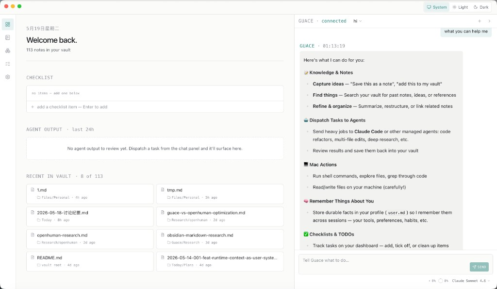

  

<h3 align="center">An AI-native personal knowledge base for your local files.</h3>

<em>macOS and Windows · local-first · your keys, your files.</em>

  

This repository hosts public downloadable builds. The source lives in a private
repository. The screenshot shows an earlier interface and will be refreshed.

## What is Guace?

Guace combines ordinary local files with one built-in main agent. Browse your
Vault, ask questions with file context, inspect the sources, organize notes and
save useful results back to files you own. Graph helps explore local links and
connections. Managed agents, task delegation and task workspaces have been removed.
No external coding-agent CLI is required.

> Connect files → ask in context → check sources → organize and save → recall.

Files remain on your disk. Provider credentials use the operating system
credential store (macOS Keychain / Windows Credential Vault). Model requests,
including relevant file context, go to the provider you configure. Local-first
indexing does not mean chat never sends document content to a remote model.

## Highlights

- **Chat with your Vault**: find, summarize and organize knowledge with one main agent.
- **File previews and editing**: Markdown, wiki-links, PDF, HTML, images, code and text.
- **Local Graph**: explore explicit links and optional on-device similarity indexes.
- **Your model provider**: configure provider credentials in Settings → Models & Providers.
- **Shell approvals**: review operations that require approval before execution.
- **Usage and checklist**: inspect model usage and keep a persistent personal checklist.
- **Optional Telegram channel**: share the main agent and sessions with your phone.

Pre-1.0: the agent can execute tools and modify local files. Review operations as
carefully as commands you would run yourself; maintain backups of important files.

## Published builds

| Platform | Download | Notes |
| --- | --- | --- |
| macOS Apple Silicon | [0.3.2 DMG](https://guace.app/api/download?arch=arm64) | Signed and notarized |
| macOS Intel | [0.3.2 DMG](https://guace.app/api/download?arch=x64) | Signed and notarized |
| Windows x64 | [0.3.3 installer](https://guace.app/api/download?platform=windows&arch=x64) | Unsigned NSIS; manual updates in this published version |

See [all releases](../../releases) for ZIPs, notes and published checksums.
These are the existing public binaries, not a new release. Upcoming Windows
updater and conditional-background changes are source-only until verified.

## Install and setup

1. Download your platform's build from [guace.app](https://guace.app/).
2. macOS: open the DMG and drag Guace to Applications. Windows: run setup.exe;
   the unsigned beta installer may trigger SmartScreen.
3. Open Guace, configure a provider in Settings → Models & Providers, and choose
   your Vault under Settings → Paths.
4. Start a session and ask the main agent to read or organize a note. Telegram is
   optional; no agent registration or task workspace setup is needed.

## Data and background operation

| Data | macOS | Windows |
| --- | --- | --- |
| Sessions, settings and derived indexes | ~/Library/Application Support/Guace/ | %APPDATA%/Guace/ |
| Vault default | ~/Documents/Guace/vault/ | Documents/Guace/vault/ (system Documents location) |
| Provider credentials | macOS Keychain | Windows Credential Vault |

Vault location is user-configurable; Windows Documents may be redirected by the
OS. Uninstalling the App does not imply deleting your Vault or credentials.

In published Windows 0.3.3, closing the window hides it to the tray; Quit stops
the App and backend, so Telegram is not available after Quit. macOS 0.3.2 can use
a previously installed launchd backend; its fallback child follows App Quit.
Do not assume source-only lifecycle changes are already in these downloads.

## Reporting bugs

Open an issue with the Guace version, platform, steps, expected/actual behavior
and relevant screenshots or redacted logs. Never include API keys or bot tokens.
For private/security-sensitive reports, contact the maintainer directly.

## License

Guace is proprietary software. Official binary releases may be downloaded and
used for free under the [Guace Freeware License](./LICENSE). Source code is not
licensed for public use. Redistribution, repackaging, modification, reverse
engineering and resale are not permitted except where required by applicable
law or with prior written permission.
